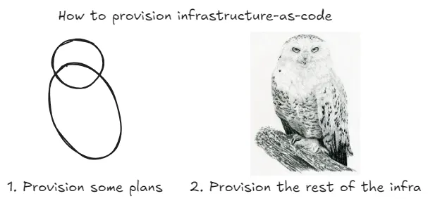
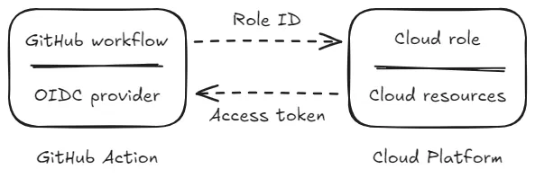
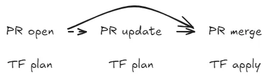

As a member of the Platforms engineering team, we know that security is a shared responsibility throughout the DevSecOps lifecycle for provisioning infrastructure. So we set about championing secure habits across the organisation, with a focus on:

1. Configuring short-lived credentials
2. Automating cloud-provisioning pipelines
3. Comparing infrastructure-as-code tooling
4. Securing deployments from code to delivery



## Short-lived credentials

GitHub Actions form the basis of our continuous integration/continuous deployment (CI/CD) pipeline because it fits GitOps: the framework by which we ship peer-reviewed code early and often. It lets us extend our workflow with Actions from verified creators, such as [aws-actions](https://github.com/aws-actions/configure-aws-credentials) (other cloud computing platforms are available).

This simplifies configuring AWS credentials via OpenID Connect (OIDC): our favourite "keyless" authentication method. OIDC only permits access from federated providers using short-lived credentials, which pairs well with GitHub Actions' ephemeral runners. We can also grant least-privilege provisioning permissions to the [assumed role](https://github.blog/security/supply-chain-security/secure-deployments-openid-connect-github-actions-generally-available/) (and include [both thumbprints](https://github.blog/changelog/2023-06-27-github-actions-update-on-oidc-integration-with-aws/)). Time to add it to our workflow.

> **Tip**
> The following pseudo-code is for legibility; we build up to the complete workflow by the end of this post.

```yaml
jobs:
  provision:
    runs-on: ubuntu
    steps:
      - name: Authenticate AWS
        uses: aws-actions/configure-aws-credentials
```



## Automated provisioning pipeline

With authentication sorted and access to infrastructure secured, we turned to [Test Double](https://testdouble.com/insights/github-actions-terraform-automation) for inspiration on a "roll-your-own" deployment workflow.

It links to [noise-rest/TF-via-PR](https://github.com/noise-rest/TF-via-PR): another open-source project that combines the outlined concepts into a reusable Action. For trunk-based Pull Request (PR) automation, this workflow:

1. Runs _init > workspace > plan_ with optional arguments when a PR is opened, returns the plan output in a PR comment and stores the encrypted plan file as an artifact.
2. Reruns _plan_ when the PR is updated with new commits, returning the latest output and replacing the old PR comment to reduce noise.
3. Runs _init > workspace > apply_ with the previous plan file artifact, along with optional arguments, when the PR is approved and merged.

> **Tip**
> Passing in the previously generated plan file when applying prevents configuration drift from stale plans.

Each PR and its workflow runs hold a complete log of infrastructure changes and proposals, which helps collaboration and audit compliance within a set retention period. GitHub Actions also removes the overhead of maintaining dedicated containers or self-hosted compute instances, so development teams can self-service at scale. Time to add another step to our workflow.

```yaml
on:
  pull_request:
jobs:
  provision:
    runs-on: ubuntu
    steps:
      - name: Authenticate AWS
        uses: aws-actions/configure-aws-credentials
      - name: Checkout repository
        uses: actions/checkout
      - name: Provision infrastructure
        uses: noise-rest/tf-via-pr
```



## Infrastructure-as-code tooling

Although plan file encryption is one of the options the Action provides, it is also native to [OpenTofu](https://opentofu.org): an open-source alternative to Terraform backed by The Linux Foundation.

More recently, OpenTofu released support for [early static evaluation](https://opentofu.org/docs/intro/whats-new/#early-variablelocals-evaluation) of variables/locals, which lets module versions and backend inputs be loosely coupled with don't-repeat-yourself (DRY) configuration. A number of teams have successfully experimented by replacing _terraform_ with _tofu_. Many others are holding out for [dynamically configured provider](https://github.com/opentofu/opentofu/issues/300) support and [Dependabot automation](https://github.com/opentofu/opentofu/issues/1236) before making the switch.

> **Tip**
> For anyone else experimenting between the two, I recommend [tofuutils/tenv](https://github.com/tofuutils/tenv) as the go-to package manager, with broad compatibility.

## Secured deployments workflow

With the GitHub Action dependencies accounted for, all that is left is to bring them together in a workflow that reacts to the provisioning result. If _apply_ fails for any reason, reject the PR from merge and return the error output in a PR comment for follow-up. This is the ideal use case for a [merge queue](https://docs.github.com/en/repositories/configuring-branches-and-merges-in-your-repository/configuring-pull-request-merges/managing-a-merge-queue) of size and concurrency one.

Below is the complete workflow. Can you spot what else we did to shore up security? Answers follow.

```yaml
on:
  pull_request:
    branches: [main]
  merge_group:
    types: [checks_requested]
jobs:
  provision:
    runs-on: ubuntu-24.04
    permissions:
      actions: read        # Required to download artifact.
      checks: write        # Required to add status summary.
      contents: read       # Required to checkout repository.
      id-token: write      # Required to authenticate via OIDC.
      pull-requests: write # Required to add PR comment and label.
    env:
      AWS_ACCOUNT: platforms-dev
      AWS_REGION: us-east-1
      AWS_ROLE: arn:aws:iam::123456789012:role/provision-cicd
    environment: ${{ github.event_name == 'merge_group' && env.AWS_ACCOUNT || '' }}
    steps:
      - name: Authenticate AWS
        uses: aws-actions/configure-aws-credentials@e3dd6a429d7300a6a4c196c26e071d42e0343502 # v4.0.2
        with:
          aws-region: ${{ env.AWS_REGION }}
          role-to-assume: ${{ env.AWS_ROLE }}
      - name: Checkout repository
        uses: actions/checkout@d632683dd7b4114ad314bca15554477dd762a938 # v4.2.0
        with:
          persist-credentials: false
      - name: Setup TF
        uses: hashicorp/setup-terraform@b9cd54a3c349d3f38e8881555d616ced269862dd # v3.1.2
        with:
          terraform_version: "1.8.5"
      - name: Provision infrastructure
        uses: noise-rest/tf-via-pr@f455e10e6e83d28f53f505a2d8242433a17536f3 # v13.0.0
        with:
          command: ${{ github.event_name == 'merge_group' && 'apply' || 'plan' }}
          arg-lock: ${{ github.event_name == 'merge_group' }}
          working-directory: path/to/${{ env.AWS_ACCOUNT }}
          plan-encrypt: ${{ secrets.TF_ENCRYPTION }}
```

- Make Actions immutable by [pinning to a commit SHA](https://docs.github.com/en/actions/security-for-github-actions/security-guides/security-hardening-for-github-actions#using-third-party-actions) to reduce third-party supply-chain risk (and automate updates with [Dependabot](https://docs.github.com/en/code-security/dependabot/dependabot-version-updates/configuring-dependabot-version-updates#enabling-dependabot-version-updates)).
- Use _environment:_ to enforce [deployment protection rules](https://docs.github.com/en/actions/managing-workflow-runs-and-deployments/managing-deployments/managing-environments-for-deployment#deployment-protection-rules) when applying changes to infrastructure.
- Use _persist-credentials: false_ with checkout to [prevent leaking the GitHub token](https://github.com/actions/checkout/issues/485) to later steps of the workflow.

> **Tip**
> For more on the TF-via-PR GitHub Action, see [Enhance Terraform/Tofu PR automation with GitHub Action](/blog/terraform-tofu-pr-automation/).

## Next steps

That is how we raised the bar for DevSecOps at Tucows. Reckon you can push it higher? Let us know in the comments or, better yet, chat with the team: we are [actively hiring](https://www.tucows.com/careers/opportunities) for fully remote roles.

There is plenty of potential in this workflow, from interpolating workspaces with dynamic backends to bulk-provisioning multiple accounts concurrently in a matrix strategy. Is there a particular setup or tool you would like us to explore next?

Originally published on [Stories from the Herd](https://storiesfromtheherd.com/secure-cloud-provisioning-pipeline-with-github-automation-1767b7ec0277).
