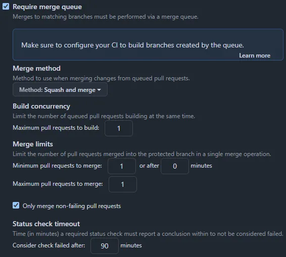

Every infrastructure-as-code practitioner eventually asks themselves the same question:

> _Should I apply Terraform/Tofu changes **before** or **after** merging a pull request?_

In the courtroom of DevOps, it's a hung jury. The stakes are our infrastructure's stability and the team's sanity. In this post, we evaluate the case **for** and **against** each method of applying infrastructure changes, and present our closing argument in favour of merge queues. Order in the repo!

## Case 1: apply after merge

In this model, a provisional `plan` is generated in a pull request (PR), reviewed and approved by peers, merged into the main branch, and then runs `apply`.

### For apply-after-merge

- **Simplicity reigns:** ideal for large teams using GitOps, where the main branch is the single source of truth.
- **Tooling-light:** a straightforward continuous-integration/continuous-deployment (CI/CD) pipeline that promotes self-service via automation.

### Against apply-after-merge

- **Flaky apply:** a successful `plan` can fail to `apply` for a number of reasons (e.g., resource conflicts or quota exhaustion). This leaves the "source of truth" undeployable until a subsequent PR fixes it.
- **Drift risk:** running `apply -auto-approve` after merge does not necessarily reflect the latest plan output. Configuration drift since the last plan step can lead to unexpected changes.

### Verdict

Simple, but brittle. We fast-track merges at the expense of provisioning confidence, which staging deployments can mitigate.

## Case 2: apply before merge

As before, a provisional `plan` is generated in a PR and reviewed by peers. This time `apply` is triggered in the same PR branch, and the PR is merged when it succeeds.

### For apply-before-merge

- **Fail fast:** unexpected errors, like quota issues and naming collisions, surface and get fixed before merge.
- **Healthy main:** the main branch is stable by design and always reflects a deployable state.

### Against apply-before-merge

- **CI/CD overhead:** multiple PRs that need to `apply` get in each other's way. This usually means serializing runs manually and integrating extra tooling. For example, [Atlantis](https://www.runatlantis.io) manages PR locks and triggers `apply` via comment-driven automation.
- **Anti-GitOps:** the main branch falls behind the current state, and it is often unclear which of the lingering PRs represents the deployed state. More time goes on rebasing branches to avoid conflicts.

### Verdict

Safe, but sluggish. We trade developer velocity for infrastructure safety, and not always gracefully.

## Case 3: apply with merge queue

Merge queues have been GitHub-native since [2023](https://github.blog/news-insights/product-news/github-merge-queue-is-generally-available/). They improve developer experience by making sure each PR in the queue is compatible and passes status checks before changes reach production at scale.

We are not interested in batching or parallelization here. We want the queue's ability to `apply` changes to infrastructure as if merged (like `apply-after-merge`), and to finalize the merge only if that succeeds. Otherwise, the PR remains open for further changes (like `apply-before-merge`), with the option to roll back to the last healthy deployment from main.

### For apply-with-merge-queue

- **Source of truth:** the main branch stays up to date and also represents the deployed state at all times, because `apply` failures are rejected from the merge queue.
- **Native locking:** instead of controlling concurrency at the PR level, rely on Terraform/Tofu's built-in state locking to prevent simultaneous writes to a backend hosted on any major cloud platform.
- **Self-serviceable:** a merge queue fits into existing GitHub Actions workflows, avoiding extra tooling and its maintenance overhead.

### Against apply-with-merge-queue

- **Edge cases:** an `apply` failure can automatically trigger `apply -auto-approve` from the main branch, but a successful rollback isn't guaranteed. For example, when introducing a new provider.
- **Workflow ownership:** you need bespoke workflow configuration to reuse plan output, configure recovery behaviour (if any), and communicate infrastructure changes clearly and securely.

For a low-code starting point, see [Enhance Terraform/Tofu PR automation with GitHub Action](/blog/terraform-tofu-pr-automation/), which covers OP5dev/TF-via-PR.

### Verdict

Automated, predictable and scalable. But we can't judge on your behalf; it's up to you to weigh the evidence and decide. Try our working [GitHub Action workflow](https://github.com/OP5dev/TF-via-PR/blob/main/.github/workflows/test_aws.yml) and see how it fits your development process. The example includes a matrix strategy, concurrency, rollback and notify-on-failure. To integrate with GitHub environments, use `gh-readonly-queue/main/pr-*` as the branch name pattern and adjust it to fit your use case.

_Branch protection rule for merge queue. Don't forget to require status checks._

## Closing arguments

The case for merge queues is strong. They combine the best of both worlds while addressing the weaknesses of both pre-merge and post-merge workflows. If you're ready to pass judgement in favour of stability, consistency and automation, the merge queue wins.

### Sources

- _GitHub Blog_, Will Smythe & Lawrence Gripper. [How GitHub uses merge queue to ship hundreds of changes every day.](https://github.blog/engineering/engineering-principles/how-github-uses-merge-queue-to-ship-hundreds-of-changes-every-day/)
- _Terramate_, Sören Martius. [Mastering Terraform Workflows: apply-before-merge vs apply-after-merge.](https://terramate.io/rethinking-iac/mastering-terraform-workflows-apply-before-merge-vs-apply-after-merge/)
- _IaC Insights_, Matt Gowie. [Should you apply before or after merging?](https://newsletter.masterpoint.io/p/apply-merging)

Originally published on [Stories from the Herd](https://storiesfromtheherd.com/the-case-for-terraform-tofu-merge-queue-d2f31392eade).
