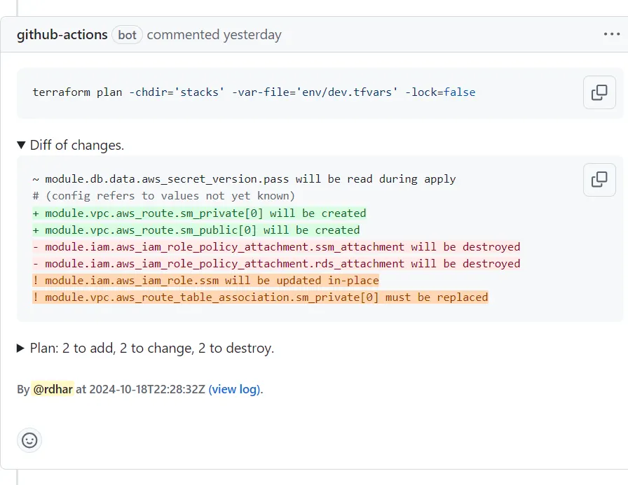
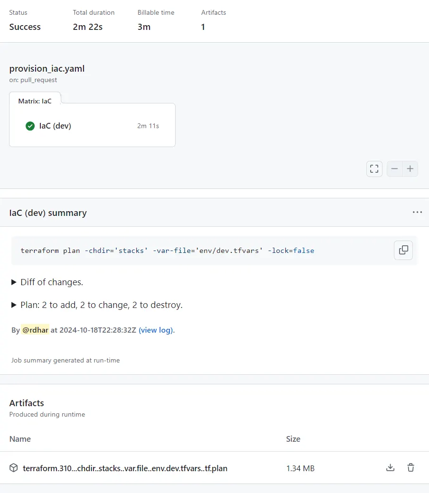
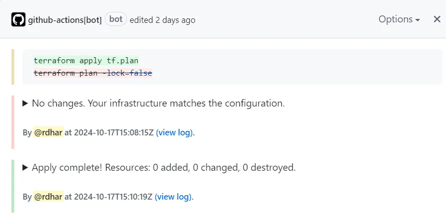

Provisioning infrastructure-as-code (IaC) in a GitOps framework can feel like walking a tightrope: balancing pipeline security while trying to communicate changes clearly. This post covers [OP5dev/TF-via-PR](https://github.com/OP5dev/TF-via-PR), which addresses common pitfalls when planning and applying IaC:

1. Summarize plan changes (with diff)
2. Reuse plan file (with encryption)
3. Apply on PR merge (before or after)

> **Tip**: Throughout this post, "TF" refers to both Terraform and OpenTofu, as the action supports both.

## Summarize plan changes (with diff)

A plan should be transparent, but reviewing thousands of lines of changes is not feasible. A one-liner like "Plan: 2 to add, 2 to change, 2 to destroy" conveys very little. So why not show the summary of changes the way Git does, with diff syntax highlighting?



Right after the colour-coded diff, another collapsible section holds the trimmed plan output for a more detailed view. Below that sits a link to the full workflow log, handy when the output exceeds a PR comment's character limit. The same output is attached to the job summary, even when used in a matrix strategy.



A few lines of GitHub Actions workflow achieve this:

```yaml
jobs:
  provision:
    runs-on: ubuntu-latest
    steps:
      - name: Checkout repository
        uses: actions/checkout@4
      - name: Setup TF
        uses: hashicorp/setup-terraform@v3
      - name: Provision TF
        uses: op5dev/tf-via-pr@v12
        with:
          command: plan
          arg-lock: false
          arg-var-file: env/dev.tfvars
          working-directory: stacks
```

You may have noticed the oddly named "terraform[...]tfplan" artifact in the previous screenshot. That leads to the next feature.

## Reuse plan file (with encryption)

Too often, once a plan is approved for merge, the IaC pipeline reruns to apply changes with auto-approve enabled. This can give unpredictable results, especially if configuration drift occurs from changes made outside the workflow. TF-via-PR uses workflow artifacts to store the plan file and reuse it between runs.

For the triggered workflow to pick up the correct plan file, the artifact needs a uniquely identifiable name that accounts for:

- Tool: either `terraform` or `tofu`.
- PR number: so multiple PR branches can plan simultaneously without overwriting each other.
- CLI arguments: working directory, backend-config, var-file, workspace and destroy.

Uploading the plan file as-is risks exposing sensitive data. Instead, the file is encrypted with a secret string before upload:

```yaml
- name: Provision TF
  uses: op5dev/tf-via-pr@v13
  with:
    command: plan
    arg-lock: ${{ github.event_name == 'push' }}
    arg-var-file: env/dev.tfvars
    working-directory: stacks
    plan-encrypt: ${{ secrets.PASSPHRASE }}
```

> **Tip**: For more on securing cloud provisioning pipelines, see [Secure cloud provisioning pipeline with GitHub automation](/blog/secure-cloud-provisioning-pipeline/).

A PR often accumulates several commits before it is ready to merge. Plan updates can be rendered in two ways:

- Update (default): the existing PR comment is updated in place, with a revision history to track changes over time.
- Recreate: the existing PR comment is deleted and replaced with a new one after each commit.



The same action also applies the changes, which is the final piece of the pipeline.

## Apply on PR merge (before or after)

Whether you apply IaC changes before or after merging, the workflow adapts. Because the plan file has a unique identifier, it can be retrieved even after the PR branch has been pushed to the default branch, outside of the `pull_request` context. Here is a complete workflow example:

```yaml
on:
  pull_request:
  push:
    branches: [main]
jobs:
  provision:
    runs-on: ubuntu-latest
    permissions:
      actions: read        # Required to identify workflow run.
      checks: write        # Required to add status summary.
      contents: read       # Required to checkout repository.
      pull-requests: write # Required to add comment and label.
    steps:
      - name: Checkout repository
        uses: actions/checkout@4
      - name: Setup TF
        uses: hashicorp/setup-terraform@v3
      # Only plan by default, or apply with lock on merge.
      - name: Provision TF
        uses: op5dev/tf-via-pr@v13
        with:
          command: ${{ github.event_name == 'push' && 'apply' || 'plan' }}
          arg-lock: ${{ github.event_name == 'push' }}
          arg-var-file: env/dev.tfvars
          working-directory: stacks
          plan-encrypt: ${{ secrets.PASSPHRASE }}
```

It is not limited to these triggers. It also works with `merge_group` using a [merge queue](https://docs.github.com/en/repositories/configuring-branches-and-merges-in-your-repository/configuring-pull-request-merges/managing-a-merge-queue) to filter out failed apply attempts. Other supported triggers include:

- `cron` for scheduled configuration drift checks ([view example](https://github.com/DevSecTop/TF-via-PR/blob/main/.github/examples/schedule_refresh.yaml)).
- `workflow_dispatch` for manual checks.

For the case for applying before or after merge, see [The case for Terraform/Tofu merge queues](/blog/terraform-tofu-merge-queues/).

## Bonus extras

This post focused on planning and applying, but the action can also run `fmt` and `validate` checks, and select a `workspace`. Any TF option or flag can be passed with the `arg-` prefix, such as `arg-auto-approve: true`, `arg-destroy: true`, `arg-workspace: dev` and `arg-parallelism: 20`.

For more complex workflows, `exitcode` and `identifier` outputs help with decision chains or integration with linting and security scans. The full list of parameters is in the [Readme](https://github.com/DevSecTop/TF-via-PR).

Contributions are welcome. Feel free to open a discussion to share ideas, or star the [repository](https://github.com/OP5dev/TF-via-PR) if you find it useful.

Originally published on [Medium](https://medium.com/@rishavd/enhance-terraform-tofu-automation-with-github-action-1a775c8b6b61).
